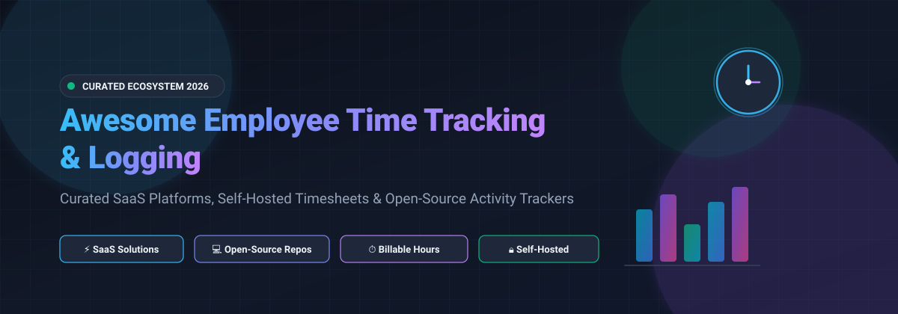

# ⏱️ Awesome-Employee-Time-Tracking-Logging

  
  
  
  
  
  

**Comprehensive directory of Top Employee Time Tracking, Timesheet Management & Productivity Logging Solutions**  
*Curated comparison of Enterprise SaaS Suites, Freelancer Billing Tools & Self-Hosted Open-Source Systems*

---

## 🧭 Table of Contents
- [🔍 Sector Overview & Market Dynamics](#-sector-overview--market-dynamics)
- [☁️ SaaS / Hosted Platforms](#️-saas--hosted-platforms)
- [💻 Open-Source GitHub Projects](#-open-source-github-projects)
- [🤝 How to Contribute](#-how-to-contribute)
- [💖 Support](#-support)
- [⭐ Star History](#-star-history)
- [⚖️ Disclaimer](#️-disclaimer)

---

## 🔍 Sector Overview & Market Dynamics

The global **time tracking and employee attendance software market** is valued at approximately **$6.1B – $6.9B (2025–2026)** and projected to surge past **$21B by 2035** at a compound annual growth rate (**CAGR of ~13.6%–14.2%**). Growth is propelled by hybrid workforce governance, strict international labor tracking mandates (such as the EU Working Time Directive and US Fair Labor Standards Act compliance), and the transition toward automated payroll integration.

The sector demonstrates **moderate market fragmentation**:
- **Enterprise Layer (Consolidated)**: Dominated by comprehensive Human Capital Management (HCM) and ERP suites (e.g., ADP, Workday, UKG, Rippling, Deel) managing unified global payroll, tax, and benefits.
- **Mid-Market & SMB Layer (Highly Fragmented)**: Characterized by healthy competition among standalone SaaS timers, productivity trackers, and open-source self-hosted point solutions rather than an entrenched, winner-take-all monopoly.

---

## ☁️ SaaS / Hosted Platforms

Below is a curated comparison of leading commercial time tracking and workforce management SaaS platforms, sorted in descending order of **Company Scale (Valuation / Revenue)**:

| Product | 🏢 Company Scale (Valuation / Revenue) | 💰 Pricing (Starting Tier) | 🎁 Free Tier / Free Trial Limits | 📝 Description |
|---------|----------------------------------------|---------------------------|----------------------------------|----------------|
| **[When I Work](https://wheniwork.com/)** | **~$1.1B Valuation** (~$35M ARR, $224M funding) | **$2.50/user/month** (Standard Scheduling & Attendance; single location) | **14-day free trial** (full access to all features, no credit card required; no permanent free tier) | Employee scheduling with built-in time clock, mobile clock-in, and attendance tracking designed for hourly workforces. |
| **[Homebase](https://www.joinhomebase.com/)** | **~$550M–$675M Valuation** ($189M funding) | **$0** (Basic plan); Paid tiers start at **$24.95/location/month** (billed annually) or $30/mo | **Free forever**: 1 physical location, up to 10 employees (time clock, employee scheduling, team messaging, 90-day timesheet history) | Free scheduling and time clock app for local businesses and retail/restaurants, featuring POS and tablet kiosk clock-ins. |
| **[Harvest](https://www.getharvest.com/)** | **~$150M ARR** (Acquired by Bending Spoons in July 2025) | **$9.00/seat/month** (billed annually, $11/mo billed monthly; base plan) | **Free forever plan**: strictly limited to 1 user and 2 active projects; **30-day free trial** of paid plans | Time tracking with integrated invoicing, billable hourly rates, and project profitability reporting across agencies and consultancies. |
| **[Clockify](https://clockify.me/)** | **~$85M ARR** (CAKE.com group; bootstrapped) | **$3.99/user/month** (Basic plan, billed annually; $4.99/mo monthly) | **Free forever plan**: unlimited users, unlimited projects, and core time tracking timers; **7-day free trial** of Pro/Enterprise tiers | High-adoption time tracker providing unlimited tracking and users on its core plan, with paid upgrades for administrative approvals and audits. |
| **[Time Doctor](https://www.timedoctor.com/)** | **~$35M–$60M ARR** (Bootstrapped, ~$525M implied valuation) | **$5.90/user/month** (Basic plan, billed annually; $8/mo monthly) | **14-day free trial** (unrestricted access to highest Premium tier features for unlimited users, no credit card required; no permanent free tier) | Productivity and employee activity monitoring offering keystroke/mouse activity, screenshot capture, and payroll calculation. |
| **[Hubstaff](https://hubstaff.com/)** | **~$22M–$33M ARR** (Bootstrapped) | **$4.99/user/month** (Starter plan, billed annually; $7/mo monthly; 2-seat minimum = $9.98/mo) | **14-day free trial** (full access to paid features, no credit card required; no permanent free tier) | Remote workforce management software featuring automated timesheets, GPS location tracking, activity level monitoring, and optional screenshots. |
| **[Toggl Track](https://toggl.com/)** | **~$14M–$33M ARR** (Bootstrapped) | **$9.00/user/month** (Starter plan, billed annually; $10/mo monthly) | **Free forever plan**: limited to up to 3 team members/workspace; **30-day free trial** of paid Premium features | Lightweight, user-friendly timer and timesheet software with one-click desktop/mobile timers, browser extensions, and billable project insights. |
| **[Buddy Punch](https://buddypunch.com/)** | **~$1M–$5M ARR** (Bootstrapped) | **$19.00/month base fee + $4.99/user/month** (Starter plan, billed annually; $5.99/user monthly) | **14-day free trial** (full access to all features and add-ons, no credit card required; no permanent free tier) | Online punch clock and employee time tracking tool with GPS stamping, geofencing, facial recognition webcam punches, and payroll integrations. |

---

## 💻 Open-Source GitHub Projects

Open-source and self-hosted tools provide data sovereignty, complete privacy control, and freedom from per-seat subscription inflation. Below are top repositories sorted by **GitHub Stars_Count (descending)**:

| Project | ⭐ GitHub_Stars | 🛠️ Tech Stack | 📖 Description |
|---------|----------|---------------|----------------|
| **[ActivityWatch](https://github.com/ActivityWatch/activitywatch)** |  | Python, Vue, Rust | **The most popular open-source automated time and activity tracker.** Runs locally on your machine without third-party servers, tracking active windows, application usage, and browser habits with complete user privacy. |
| **[Leantime](https://github.com/Leantime/leantime)** |  | PHP, JavaScript | **Goals-focused project management system with integrated time logging.** Designed with non-project managers, ADHD, and small teams in mind—combining task kanbans, milestone roadmaps, and timesheet logging into one platform. |
| **[solidtime](https://github.com/solidtime-io/solidtime)** |  | PHP (Laravel), Vue.js | **Modern, beautifully crafted open-source time tracking application.** Positioned as a modern, self-hostable alternative to Clockify and Toggl, featuring multi-organization support, project time tracking, billing rates, and client management. |
| **[Kimai](https://github.com/kimai/kimai)** |  | PHP (Symfony), Twig | **Mature, full-featured web-based multi-user timesheet application.** Features customer/project/activity hierarchies, billable hour tracking, multi-currency invoicing, export to PDF/Excel, and approval plugins for agencies and enterprises. |
| **[Wakapi](https://github.com/muety/wakapi)** |  | Go, SQLite/PostgreSQL | **Minimalist, self-hosted WakaTime-compatible coding time tracker.** Gathers coding telemetry directly from code editor plugins (VS Code, JetBrains) to generate detailed programming statistics and work summaries automatically. |
| **[Watson](https://github.com/jazzband/Watson)** |  | Python (CLI) | **Lightweight, fast CLI time tracker.** Track project and tag times directly from your terminal, generate clean reporting summaries, and sync tracking logs across team machines effortlessly. |
| **[Timewarrior](https://github.com/GothenburgBitFactory/timewarrior)** |  | C++ (CLI) | **Command-line time tracking and reporting utility from the creators of Taskwarrior.** Tracks elapsed time, supports ad-hoc categorization and tags, and outputs interval reports. |
| **[klog](https://github.com/jotaen/klog)** |  | Go (CLI) | **Command-line time tracker with plain-text file storage.** Version-controllable with Git, human-readable file formats, and concise CLI commands for logging intervals and calculating totals. |
| **[titra](https://github.com/titraio/titra)** |  | JavaScript (Node, Meteor) | **Modern open-source project time tracking for freelancers and teams.** Docker-deployable self-hosted web app with lightweight project management, timer widgets, and timesheet reports. |
| **[team-timesheets](https://github.com/thdk/team-timesheets)** |  | Ruby on Rails | **Simple, minimalist timesheet web app.** Built as a clean and lightweight replacement for legacy spreadsheet time logging for remote and distributed teams. |
| **[TimeSheets](https://github.com/BjoernKW/TimeSheets)** |  | Java, Spring Boot | **Self-hosted project timesheet application.** Straightforward timesheet submission and project reporting suited for Java environments. |

---

## 🤝 How to Contribute

Contributions are warmly welcomed! Help keep this directory fresh, accurate, and comprehensive:

1. 🍴 **Fork the repo**.
2. 🌿 **Create a feature branch**: `git checkout -b feature/add-new-tool`.
3. 📝 **Add or update entries** in `README.md` following the established table structure (include specific starting pricing and verified free tier caps).
4. 🚀 **Submit a Pull Request** with a concise description of your changes.

---

## 💖 Support

If you found this list helpful, consider showing your support:
- ⭐ **Star this repository** to help others discover it!
- 🍴 **Fork and share** it with colleagues, agency peers, and teams.
- ☕ **Buy a coffee & sponsor ongoing maintenance:**  
  

---

## ⭐ Star History

---

## ⚖️ Disclaimer

- This is a **community-curated directory** provided for informational purposes only—not an official product endorsement.
- Time tracking software involves employee workplace data and potential monitoring technologies (such as GPS geofencing, keystroke frequency, or automated screenshot capture). Organizations must adhere to local labor laws, guarantee transparent usage policies, and respect privacy compliance standards (e.g., GDPR, CCPA).
- Pricing structures, feature tiers, and free trial conditions are subject to vendor updates. Always confirm current plan specifications directly on the official vendor websites before purchasing.

---

  Built with ❤️ for freelancers, agency leads, ops managers, and engineering teams everywhere.

